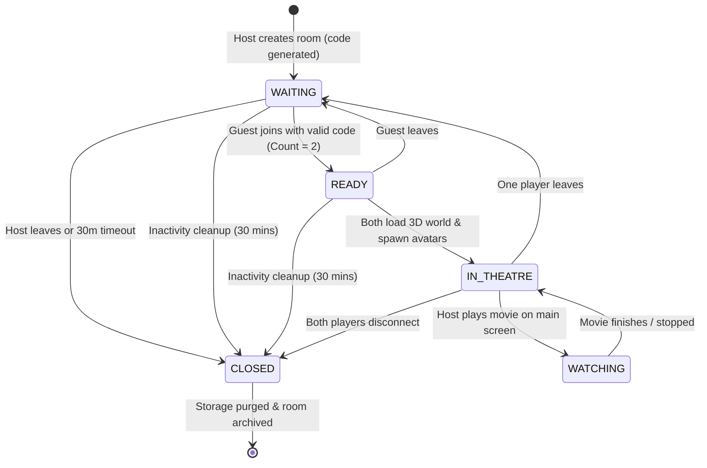
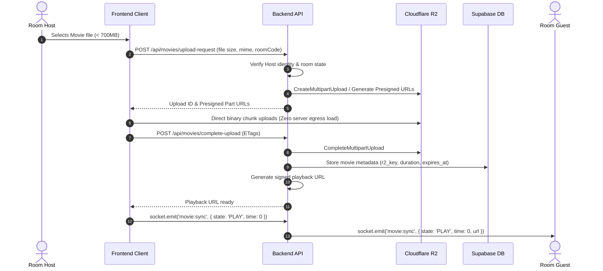

# 2GETHER: Master Project Architecture & System Design
**Tagline:** *"Two Hearts. One Theatre. One Movie."*

---

## 1. Executive Summary & Vision

**2GETHER** is a bespoke, cinematic multiplayer virtual theatre experience strictly crafted for exactly two people. Whether separated by miles, timezones, or travel, couples, best friends, and family members enter a private, cozy 3D virtual cinema, walk around with adorable stylized 3D avatars, sit side-by-side in plush velvet seats, stream their favorite films, and interact with synchronized video and real-time chat.

---

## 2. Technology Stack & Architectural Decision Records (ADRs)

| Component | Choice | Version / Standard | Architectural Rationale |
|---|---|---|---|
| **Frontend Framework** | React + Vite + TypeScript | React 18.3, Vite 5.4, TS 5.6 | Maximum performance, sub-second HMR, rock-solid stability with WebGL/Three.js ecosystem. |
| **3D Rendering** | Three.js + React Three Fiber + Drei | Three 0.169, R3F 8.17, Drei 9.117 | Declarative 3D scene graphs, reactive state binding, built-in camera controls and math helpers. |
| **Client State** | Zustand | v5 | Zero-boilerplate, high-performance state store decoupled from React rendering loop. |
| **Styling & Theme** | Tailwind CSS | v3.4 | Dark purple, midnight blue, warm golden cinematic lighting, soft pink highlights, glassmorphic UI. |
| **Backend Runtime** | Node.js + Express + TypeScript | Node 22, Express 4.21, TS 5.6 | Fast I/O, enterprise-grade typing, native integration with Socket.IO and AWS SDK. |
| **Real-time Networking** | Socket.IO | v4.8 | Low-latency binary/JSON packet transmission, automatic fallback, room-level namespaces, heartbeat detection. |
| **Database & Auth** | Supabase PostgreSQL + Auth + RLS | Postgres 15+ / Supabase | Strong ACID guarantees, UUID generation, Row-Level Security for room-isolated data, triggers for strict capacity. |
| **Storage Engine** | Cloudflare R2 | S3-Compatible API via AWS SDK v3 | Zero egress fees, presigned multipart upload URLs, temporary object lifecycle with automatic purge. |
| **Security & Rate Limiting** | Express-Rate-Limit + Helmet + Zod | Modern standard | Strict payload validation, anti-DDoS, security headers, server-authoritative room state. |

---

## 3. Strict 2-Player Room State Machine

A fundamental invariant of **2GETHER** is: **Capacity = STRICTLY 2**. A 3rd player can NEVER enter an active room.

### Server-Authoritative Capacity Rules:
1. **Join Validation:** When a socket requests `room:join`, the server verifies the current member count. If `count >= 2`, the request is immediately rejected with error code `ROOM_FULL`.
2. **Database Trigger:** The `public.room_participants` table enforces a PostgreSQL `BEFORE INSERT` trigger (`check_room_capacity`) preventing concurrent race conditions.
3. **Reconnection Window:** If a known participant disconnects temporarily, their slot is held for 120 seconds with state `RECONNECTING`.

---

## 4. 3D Theatre & Character Architecture

### Spatial Layout
- **Cinema Hall:** Dimensions 24m × 16m with velvet walls, dark purple carpeting, and warm golden sconces.
- **Cinema Screen:** 16:9 ultra-wide cinema screen positioned at Z = -10. Uses a Three.js `VideoTexture` dynamic canvas material for synchronized streaming.
- **Couple Seating:** Two luxury golden-trimmed velvet seats positioned at Z = 1.0, Y = 0.4.
- **Interaction Zones:** Step into seat collider -> prompt `Press E to Sit / Stand`.

### Stylized 3D Character Rigging & Animation States
Characters are crafted with cute proportions:
- Smooth pill-shaped body, oversized head, expressive eyes, cute ears, soft blush cheeks, and customizable color schemes.
- **Animation States:**
  - `IDLE`: Gentle breathing bobbing motion and subtle ear tilt.
  - `WALK`: Rhythmic footstep sway and arm swing.
  - `RUN`: Dynamic tilt forward, energetic head bounce.
  - `SIT`: Anchored to seat transform, relaxed arm posture, head tracking camera.

---

## 5. Movie System & Cloudflare R2 Storage Architecture

---

## 6. Live Chat & Multiplayer Synchronization

- **Tick Rate:** 20 Hz movement updates with client-side linear interpolation (LERP) for jitter-free 60 FPS rendering.
- **Data Packet Format:**
  - `player:move`: `{ x, y, z, rotY, animState, isSitting }`
  - `chat:message`: `{ id, senderId, senderName, message, timestamp }`
  - `movie:control`: `{ action: 'PLAY' | 'PAUSE' | 'SEEK', timestamp, currentTime }`

---

## 7. Security Hardening Checklist
- [x] Input sanitization via Zod on all endpoints.
- [x] Cloudflare R2 credentials confined strictly to backend environment.
- [x] Supabase Row Level Security (RLS) active on all tables.
- [x] CORS whitelist restricted to authorized frontend origins.
- [x] Automatic 30-minute room garbage collection.
- [x] Hard file upload size ceiling at 700MB.
